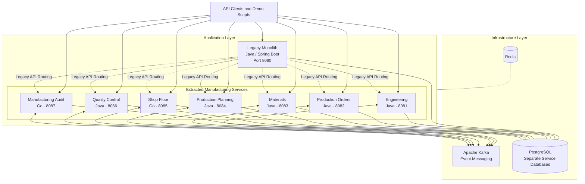
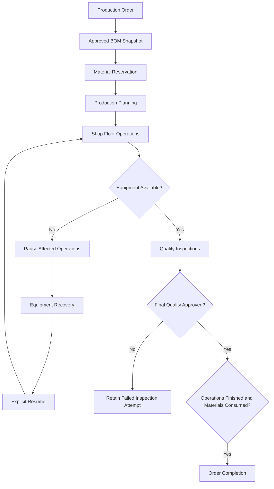

# Conveyor Manufacturing

[](https://github.com/Fogacrosstag/conveyor-manufacturing/actions/workflows/ci.yml)


Backend for production orders, material reservations, manufacturing operations and quality inspections. The repository contains a Java monolith and seven services extracted from it.

**Java 21 / Spring Boot · Go · PostgreSQL · Kafka · Redis · Docker Compose**

## Project Highlights

- **Incremental Legacy Modernization** — A Java monolith coexists with seven extracted services, preserving legacy API compatibility during migration.
- **Polyglot Backend Architecture** — Java 21 and Spring Boot power core manufacturing capabilities, while Go handles shop-floor operations and manufacturing audit.
- **Event-Driven Communication** — Kafka messaging with transactional outbox and inbox processing supports reliable, at-least-once event delivery.
- **Database Ownership** — Each application has a dedicated PostgreSQL database and role, maintaining clear service boundaries.
- **Manufacturing Workflow Automation** — Production orders, BOM snapshots, material reservations, capacity planning, equipment recovery and quality inspections.
- **Failure Handling and Idempotency** — Duplicate event protection, equipment failure and recovery scenarios, and explicit operation resume.
- **Automated Verification** — GitHub Actions validates Java and Go components, integration scenarios, legacy API compatibility and migration workflows.
- **Observability** — Prometheus metrics, Grafana dashboards and application health endpoints.

## Technology Stack

| Category | Technology | Role |
|---|---|---|
| Backend | Java 21, Spring Boot | Manufacturing services, business logic and legacy application |
| Backend | Go | Shop-floor operations and manufacturing audit |
| Database | PostgreSQL | Persistent storage with database ownership per application |
| Messaging | Apache Kafka | Asynchronous event-driven communication |
| Reliability | Transactional Outbox & Inbox | Reliable event publishing and duplicate processing protection |
| Infrastructure | Docker, Docker Compose | Containerized local development and integration environments |
| Build & Testing | Maven, Go Toolchain, Python | Builds, automated tests and end-to-end verification |
| CI/CD | GitHub Actions | Automated build, testing and integration verification |
| Monitoring | Prometheus, Grafana | Metrics collection and visualization |
| Caching Infrastructure | Redis | Included in the local infrastructure stack |

## Run

Requires Docker Compose v2 and Python 3.10+. The first build downloads images and dependencies.

```bash
cp .env.example .env
docker compose up --build -d --wait --wait-timeout 300
python3 scripts/demo.py
```

The demo creates an order, reserves stock, schedules operations, handles an equipment failure and completes quality checks. Seed requests are idempotent; each demo run creates a new order and consumes stock.

To run the monolith baseline, stop the other stack first:

```bash
docker compose down
docker compose -f docker-compose.yml -f compose.baseline.yml up --build -d --wait --wait-timeout 300
BASELINE=true python3 scripts/demo.py
```

Both modes use the same host ports and separate named volumes. On PowerShell, set `$env:BASELINE="true"` before running the baseline demo.

## Services

| Application | Port | Owns |
|---|---:|---|
| legacy-monolith | 8080 | Product catalog and legacy API routing |
| engineering-service | 8081 | Specifications and BOM revisions |
| production-order-service | 8082 | Order lifecycle |
| material-service | 8083 | Stock, reservations and consumption |
| production-planning-service | 8084 | Capacity lanes and scheduling |
| shop-floor-service | 8085 | Operations and equipment state |
| quality-control-service | 8086 | Measurements and inspection history |
| manufacturing-audit-service | 8087 | Event history |

Shop-floor and audit are written in Go. The other applications use Java. Each application owns a separate PostgreSQL database and role. Host ports bind to loopback.

## Architecture

### Quick Architecture Summary

Conveyor Manufacturing demonstrates incremental modernization of an existing manufacturing backend using a hybrid monolith-and-microservices architecture.

**System Design**

- **Legacy Monolith:** Preserves existing API compatibility while manufacturing capabilities are progressively extracted into independent services.
- **Manufacturing Services:** Seven extracted services manage engineering, production orders, materials, production planning, shop-floor operations, quality control and manufacturing audit.
- **Service Communication:** Apache Kafka enables asynchronous communication between components using domain events.
- **Data Ownership:** Each application maintains its own PostgreSQL database and database role, establishing clear service boundaries.
- **Event Reliability:** Transactional outbox and inbox processing support at-least-once delivery and prevent duplicate event IDs from applying the same mutation twice.
- **Operational Visibility:** Prometheus and Grafana provide application metrics and monitoring.
- **Deployment:** Docker Compose orchestrates the local application and infrastructure stack.

**Modernization Approach**

The project follows an incremental migration strategy rather than replacing the existing application in a single deployment. Business capabilities can transition from local monolith ownership to independent services while retaining legacy API compatibility.

The implementation includes ownership states, controlled data migration, reconciliation procedures and rollback documentation.

The [system overview](docs/architecture/system-overview.md) includes a Mermaid deployment diagram. See [engineering decisions](docs/architecture/engineering-decisions.md) for design trade-offs and [security review](docs/security/SECURITY_REVIEW.md) for local-only credentials and deployment limitations.

### Architecture Overview

The system supports incremental modernization of an existing manufacturing application. The legacy monolith retains compatibility with existing API consumers while extracted services take ownership of individual manufacturing capabilities.

The diagram below presents the logical service boundaries and shared infrastructure.



Each extracted service has a defined business responsibility and its own PostgreSQL database and role. Kafka supports asynchronous communication through transactional outbox and inbox processing.

The diagram is a conceptual architecture overview rather than an exact network topology or a complete map of event subscriptions. Redis is shown as shared infrastructure without assigning specific cache responsibilities.

## Demo Scenarios

The project includes an automated end-to-end demonstration that exercises the manufacturing workflow through REST APIs, PostgreSQL and Kafka.

The demonstration is implemented in [`scripts/demo.py`](scripts/demo.py).

### Manufacturing Workflow Verification

| Scenario | Demonstrated Behavior |
|---|---|
| Production Order Creation | Creates a manufacturing order using an approved bill of materials revision |
| Material Reservation | Reserves the materials required for production |
| Production Planning | Dispatches seven manufacturing operations to capacity lanes |
| Operation Authorization | Verifies that operations cannot start before the required authorization and predecessor conditions are satisfied |
| Equipment Failure | Simulates an equipment failure and verifies that affected operations are paused |
| Equipment Recovery | Processes a recovery event and explicitly resumes paused operations |
| Operation Completion | Completes manufacturing operations and checks repeated completion requests |
| Quality Control | Executes mandatory quality inspections and records inspection results |
| Inspection Failure and Retry | Simulates a failed inspection, retains the failure and verifies successful reinspection |
| Production Order Completion | Verifies that operations, material consumption and quality approval satisfy completion requirements |
| Legacy API Compatibility | Compares the legacy API response with the current production order representation |
| Manufacturing Audit | Verifies that completion events appear in the audit history without duplicate event IDs |

### Running the Demonstration

Start the application stack using Docker Compose, then execute:

```bash
python3 scripts/demo.py
```

The demonstration creates a new production order and exercises the manufacturing workflow, including failure and recovery scenarios.

### Verification Scope

The demonstration checks:

- Manufacturing order lifecycle and state transitions.
- Material reservation and consumption.
- Production scheduling and operation dependencies.
- Equipment failure, recovery and explicit operation resume.
- Quality inspection failure and retry.
- Idempotent operation completion requests.
- Legacy API compatibility.
- Manufacturing audit event uniqueness.

The demonstration is an automated integration scenario rather than an interactive user interface. It requires the application stack and supporting infrastructure to be running.

## Workflow

### Manufacturing Process

The following diagram illustrates the main production workflow, including equipment failure handling and the conditions required for order completion.



An order keeps a snapshot of its approved BOM. Submission reserves the required materials; planning dispatch assigns seven operations to capacity lanes. Operations require start authorization, completed predecessors and available equipment.

Equipment failure pauses affected operations. A later recovery event permits explicit resume. Failed inspections retain their previous attempts. Order completion requires three facts: operations finished, materials consumed and final quality approved.

The outbox is committed with business state. Consumers commit inbox records with their effects before acknowledging Kafka. Delivery is at-least-once; repeated event IDs do not apply the same mutation twice.

## Legacy API and migration

The monolith retains `/api/legacy/...` paths and routes requests to the current owner. Ownership is stored as LOCAL, FROZEN or REMOTE. An unavailable remote service does not trigger a local write fallback.

Migration requires stopped client traffic, no active manufacturing orders and drained events. See the [migration runbook](docs/modernization/data-migration.md) for snapshot transfer, reconciliation and rollback.

## Tests

With Java 21, Maven, Go and Docker installed:

```bash
mvn -B -ntp verify
python3 scripts/go_tasks.py test
python3 scripts/go_tasks.py vet
python3 scripts/demo.py
python3 tests/api_regression.py
python3 tests/broker_recovery.py
```

The Java tests use PostgreSQL Testcontainers. API scenarios cover shortages, concurrent reservations, inspection failures and duplicate messages. The migration test compares records before and after forward/reverse transfer. Commands and prerequisites are listed in the [test matrix](docs/testing/TEST_MATRIX.md).

Historical local results and the later successful GitHub Actions verification are documented separately in the [test matrix](docs/testing/TEST_MATRIX.md).

## Development

`go.mod` and `go.sum` are committed for all three Go modules. Build and test commands use read-only dependency resolution; run `python3 scripts/go_tasks.py tidy` after intentionally changing dependencies.

```bash
make format        # google-java-format 1.24.0 and gofmt
make format-check  # also enforced in CI
python3 scripts/go_tasks.py build
```

Java formatting is checked during Maven's validation phase. Formatting does not require Docker; the full integration suite does.

## Monitoring

- Prometheus: http://localhost:9090
- Grafana: http://localhost:3000 — local credentials `admin` / `local-grafana-only`
- Java health and metrics: `/actuator/health`, `/actuator/prometheus`
- Go health and metrics: `/health`, `/metrics`

See [metric definitions](docs/architecture/observability.md) for measurement boundaries.

## Implementation notes

Writes are serialized per database. Some collection endpoints and audit queries scan their records. Scheduling uses a fixed route with configurable durations and capacity lanes; execution in the demo does not wait for planned wall-clock times.

The stack uses one PostgreSQL server and one Kafka broker. Equipment events are simulated. Authentication, shift calendars and online migration of active orders are outside the current implementation.

## Reference

- [API guide](docs/api/API.md) and [OpenAPI](docs/api/openapi.yaml)
- [Service boundaries](docs/architecture/service-boundaries.md)
- [Database schema](docs/database/SCHEMA.md)
- [Event contract](docs/events/CONTRACT.md)
- [Failure handling](docs/architecture/failure-handling.md)

Use `docker compose logs --tail=100` for diagnostics. `docker compose down` preserves volumes; adding `-v` removes the selected stack's data.
