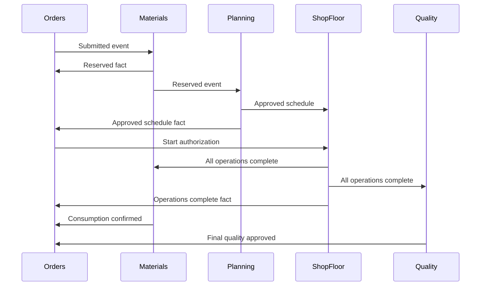

# Event flow

Arrows above are Kafka events; Kafka is omitted as a participant to keep the diagram readable. The actual envelope and topics are in `docs/events/CONTRACT.md`. Audit independently consumes every domain topic. Engineering/product validation uses synchronous HTTP before order creation.

The baseline performs equivalent handler dispatch inside the existing transaction and writes events to `legacy.events`. During partial extraction, local capabilities remain synchronous and remote capabilities consume legacy events. The legacy consumer must be enabled to receive responses from extracted owners.
