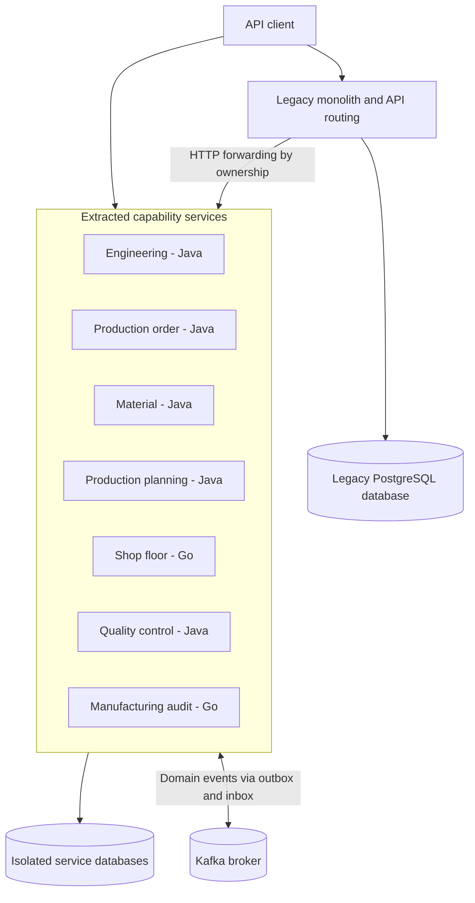

# System overview

This diagram describes the hybrid deployment of Conveyor Manufacturing. It is a local demonstration architecture, not a production-scale infrastructure design.

## Hybrid architecture



## Service ownership

The legacy monolith retains product catalogue ownership and compatibility with the existing legacy API.

Seven extracted services own their respective manufacturing capabilities:

| Service | Technology | Responsibility |
|---|---|---|
| Engineering | Java / Spring Boot | Specifications and bill-of-materials revisions |
| Production order | Java / Spring Boot | Production order lifecycle |
| Material | Java / Spring Boot | Stock, reservations and consumption |
| Production planning | Java / Spring Boot | Capacity lanes and operation scheduling |
| Shop floor | Go | Manufacturing operations and equipment state |
| Quality control | Java / Spring Boot | Measurements and inspections |
| Manufacturing audit | Go | Manufacturing event history |

Each deployed application uses its own logical PostgreSQL database and database role. The local deployment uses one PostgreSQL server.

## Communication

### Synchronous communication

The legacy monolith preserves compatibility with existing API paths and forwards requests to extracted services according to capability ownership.

Ownership can be LOCAL, FROZEN or REMOTE.

An unavailable remote service does not trigger a fallback to local writes.

### Asynchronous communication

Kafka carries domain events between capabilities.

The transactional outbox records publication intent alongside business state. Consumers use inbox records to deduplicate processed events.

Delivery is at least once. The system does not claim exactly-once message delivery.

## Deployment modes

### Baseline mode

The legacy monolith hosts the capability implementations internally. This mode is used to characterize and verify legacy API behaviour.

### Hybrid mode

Extracted services run independently while the legacy monolith maintains compatibility and routing for the remaining legacy API.

Both deployment modes are exercised by the repository's verification workflow.

## Migration constraints

Migration requires quiescent client traffic, drained events and no active manufacturing orders.

Forward and reverse migration include reconciliation checks.

Online migration of active production orders is outside the current implementation.

## Operational limitations

- The local deployment uses a single Kafka broker.
- PostgreSQL databases share one physical PostgreSQL server.
- Business writes are serialized per database using an advisory lock.
- Equipment events are simulated.
- Production authentication and authorization are not implemented.
- High availability and production-scale load testing are outside the demonstrated scope.

## Related documentation

- [Service boundaries](service-boundaries.md)
- [Event-driven architecture](event-driven-architecture.md)
- [Failure handling](failure-handling.md)
- [Observability](observability.md)
- [Migration runbook](../modernization/data-migration.md)
- [Engineering decisions](engineering-decisions.md)
- [Security review](../security/SECURITY_REVIEW.md)
```

